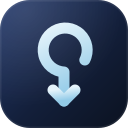
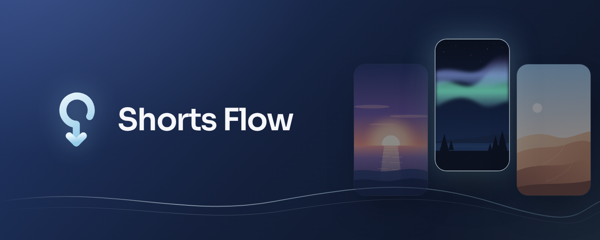
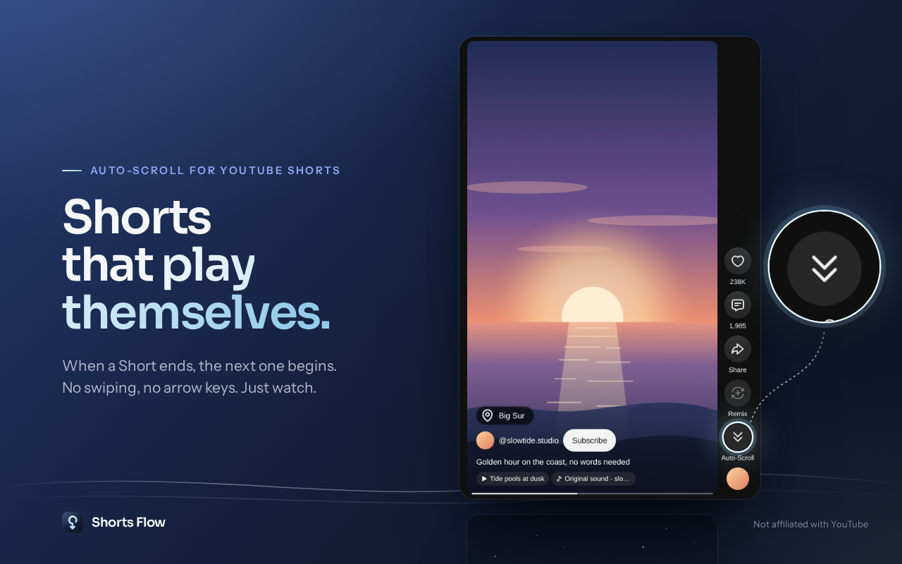
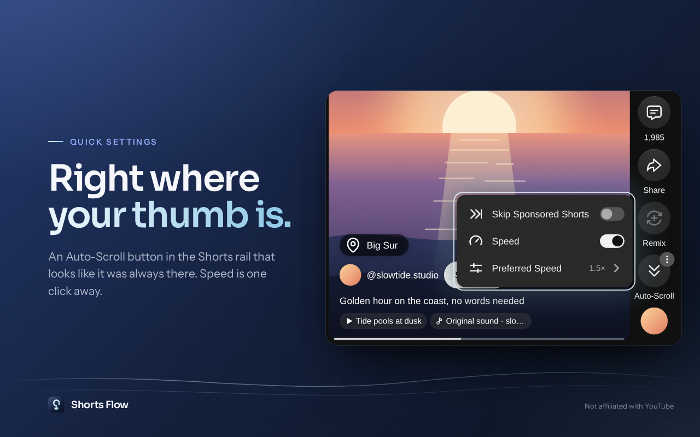
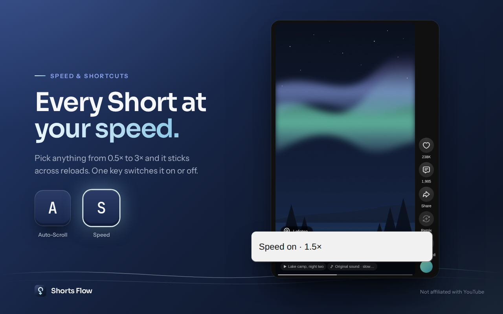
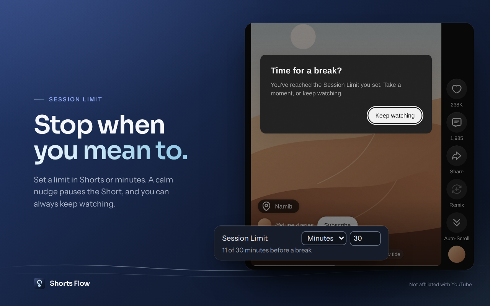
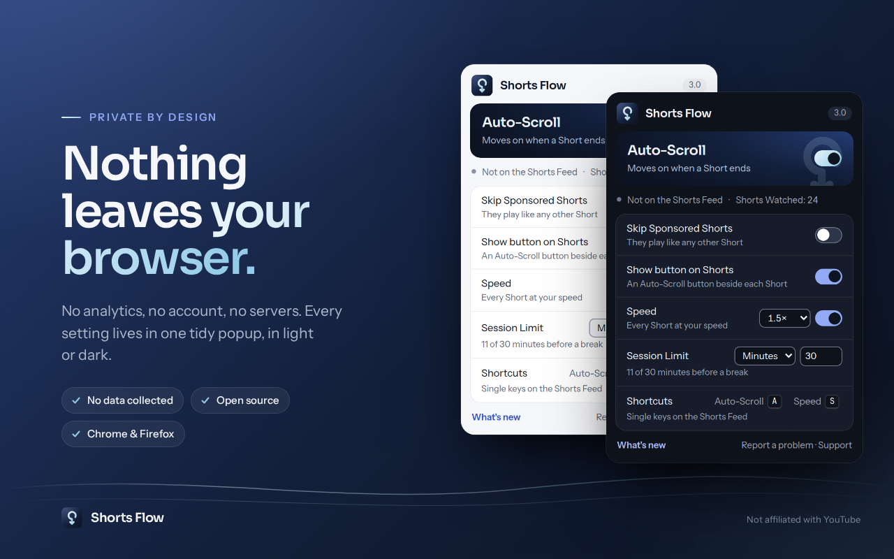

<div align="center">



# Shorts Flow

**Watch YouTube Shorts hands-free.**
When a Short ends, the next one begins. No swiping, no arrow keys. Just watch.

[Chrome Web Store](https://chromewebstore.google.com/detail/shorts-flow-auto-scroll-a/kfkkpgeijmfhmdhlcnoecidgceljccdf) &nbsp;·&nbsp;
[Firefox Add-ons](https://addons.mozilla.org/firefox/addon/shorts-flow/) &nbsp;·&nbsp;
[Website](https://shortsflow.cptdawn.dev) &nbsp;·&nbsp;
[Privacy](https://shortsflow.cptdawn.dev/privacy)

[](https://github.com/CPT-Dawn/Shorts-Flow/actions/workflows/ci.yml)
[](https://github.com/CPT-Dawn/Shorts-Flow/releases/latest)
[](LICENSE)

<br>



</div>

<br>

## Lean back

Shorts Flow turns YouTube's desktop Shorts feed into something you can watch while you cook, stretch or simply sit back. It's built to feel as if it was always there: one quiet button in the Shorts action rail, styled like YouTube's own, and a toolbar popup for everything else.

<p align="center">
  
</p>

- **Auto-Scroll.** Moves on the moment a Short ends, at any speed, and stays on or off exactly as you left it.
- **It waits for you.** Never moves on while a Short is paused, the comments or description are open, a menu is open, you're typing, or you've just scrolled yourself. The Short simply plays again.
- **Speed.** Every Short at your favourite pace, from 0.5× to 3×, remembered across reloads.
- **Shortcuts.** <kbd>A</kbd> for Auto-Scroll, <kbd>S</kbd> for Speed. Pick other keys in the popup.
- **Session Limit.** A count of the Shorts you've watched, and if you like, a gentle nudge to take a break.
- **Skip Sponsored Shorts.** Optional and off until you turn it on. It moves past Sponsored Shorts in the feed. It doesn't block ads.
- **Calm when things go wrong.** If the next Short can't be found, a quiet notice offers a retry. The page never reloads.

<table>
  <tr>
    <td width="50%"></td>
    <td width="50%"></td>
  </tr>
  <tr>
    <td width="50%"></td>
    <td width="50%"></td>
  </tr>
</table>

<p align="center"><sub>▶ Prefer motion? Watch the <a href="docs/release/store-art/promo-video.mp4">40-second tour</a>.</sub></p>

## Private by design

Shorts Flow collects nothing. There's no analytics, no tracking, no account and no server. Your settings never leave your browser. It asks for two things: the `storage` permission, and access to youtube.com. It's free, with no ads, upsells or tip jar.

Every control works with a keyboard and a screen reader, follows your light or dark theme, and respects reduced motion.

## Install

| Browser | Get it from |
|---|---|
| Chrome, Edge, Brave, Opera, Vivaldi | [Chrome Web Store](https://chromewebstore.google.com/detail/shorts-flow-auto-scroll-a/kfkkpgeijmfhmdhlcnoecidgceljccdf) |
| Firefox (desktop, 142+) | [Firefox Add-ons](https://addons.mozilla.org/firefox/addon/shorts-flow/) |

Each [release](https://github.com/CPT-Dawn/Shorts-Flow/releases/latest) also carries the Chrome and Firefox packages, plus a source bundle that rebuilds to the same package.

Something off? [Report a problem](https://shortsflow.cptdawn.dev/report) or [open an issue](https://github.com/CPT-Dawn/Shorts-Flow/issues).

<br>

<details>
<summary><b>Building from source</b></summary>

<br>

Needs [Bun](https://bun.sh) and Node.js (WXT, Vitest and web-ext run on Node).

```sh
bun install
bunx playwright install chromium firefox   # once, for the browser tests
bun run dev                                # or dev:firefox
```

| Script | What it does |
|---|---|
| `bun run dev` / `dev:firefox` | Development build with live reload in Chrome / Firefox |
| `bun run build` | Chrome and Firefox builds in `.output/` (`build:chrome`, `build:firefox` for one) |
| `bun run zip` | Store zips for both, plus the Firefox source bundle |
| `bun run typecheck` | Strict TypeScript check |
| `bun run test` | All Vitest projects: `test:lifecycle` (Node), `test:tools` (Node) and `test:browser` (Playwright, Chromium and Firefox) |
| `bun run test-page` | Makes an anonymised Shorts Feed test page from a local capture (see `tests/pages/README.md`) |
| `bun run lint:firefox` | `web-ext lint` on the Firefox build |
| `bun run icons` | Redraws `public/icon/` from `docs/design/brand` |
| `bun run store-art` | Store screenshots, promo tiles and promo video, from the real extension |

CI runs the typecheck, every test project, both builds and `web-ext lint` on each push and pull request.

**Releasing.** Work through `docs/release/checklist.md`, then push a signed `v*` tag that matches `package.json`. The Release workflow re-runs the gate and attaches the zips to a GitHub Release. Store uploads stay manual, using `docs/release/store-listing.md`.

**Map.**
`src/entrypoints/` holds the thin WXT entrypoints, `src/popup/` the popup, and `public/_locales/en/messages.json` every user-facing string.
`tests/lifecycle/` runs in Node with WXT's fake browser, and `tests/browser/` runs in real headless Chromium and Firefox against the anonymised pages in `tests/pages/`.
Domain words are in `GLOSSARY.md`, decisions in `docs/adr/`, and the Tideline brand in `docs/design/brand/`.

</details>

<br>

<div align="center">
<sub>
Made with care by <a href="https://cptdawn.dev">CPT Dawn</a> · <a href="LICENSE">MIT</a><br>
Not affiliated with YouTube. YouTube™ is a trademark of Google LLC.
</sub>
</div>
